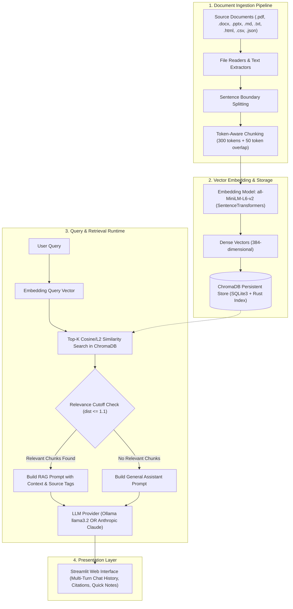
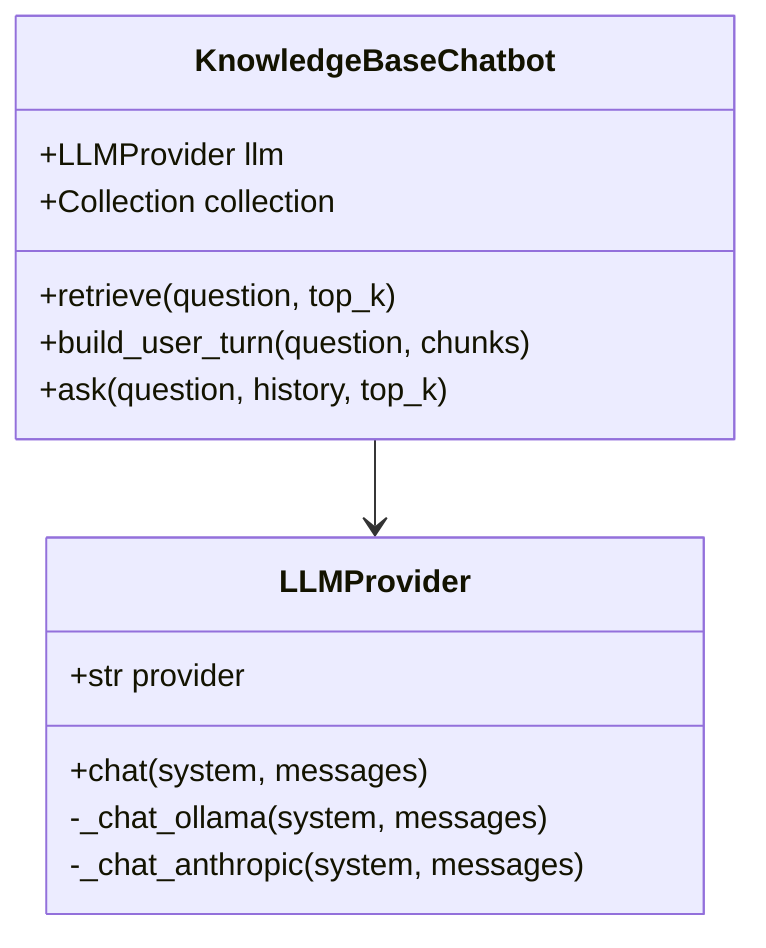
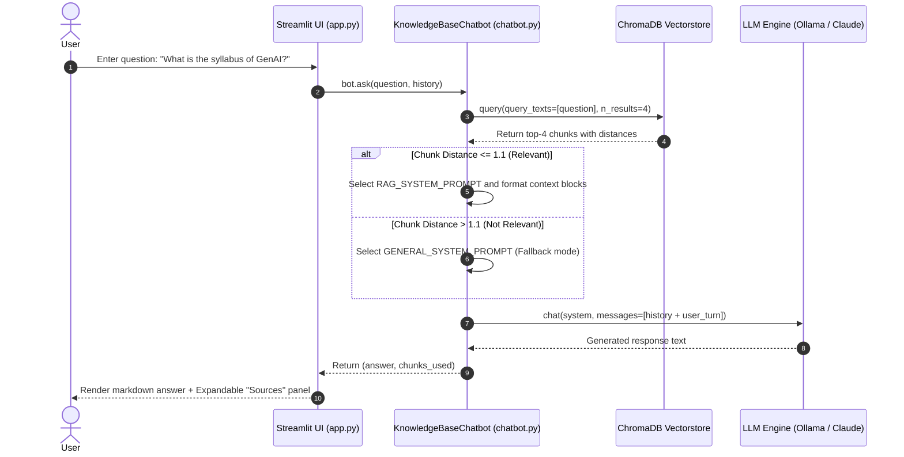

# Technical Project Report: Personal Knowledge Base Assistant (Local-First RAG)

**Project Name:** Personal Assistant & Knowledge Base Chatbot  
**Repository:** `knowledge-base-chatbot`  
**Primary Tech Stack:** Python 3.12, Streamlit, ChromaDB, Sentence-Transformers, PyTorch, Ollama / Anthropic Claude  
**Target Audience:** Engineering Staff, Faculty, Peers, and Collaborators  

---

## 1. Executive Summary

The **Personal Knowledge Base Assistant** is an intelligent, local-first Retrieval-Augmented Generation (RAG) conversational agent. Unlike traditional rigid document QA bots that fail or refuse to respond when a user prompt is outside the indexed domain, this system serves a dual role:

1. **Grounded Document Specialist:** Answers complex domain-specific questions by retrieving exact passages from user-supplied documentation (.pdf, .docx, .pptx, .md, .txt, .html, .csv, .json) with traceable source citations.
2. **Day-to-Day Personal AI Assistant:** Seamlessly falls back to general-purpose conversational intelligence when no relevant documentation exists in the local database.

The system is designed for **data privacy, modularity, and operational independence**, capable of executing 100% offline using local open-weight models (via Ollama) or scaling to state-of-the-art hosted frontier models (via the Anthropic API).

---

## 2. System Architecture

The application is structured into four cohesive pipelines: **Document Ingestion**, **Vector Embedding & Storage**, **Semantic Retrieval & Context Synthesis**, and **Interactive Presentation**.



---

## 3. Technical Breakdown of Core Components

### 3.1 Document Ingestion & Parsers (`ingest.py`)

The ingestion engine processes diverse file types into normalized text streams without relying on external cloud APIs:

| File Format | Parser Library | Extraction Technique |
| :--- | :--- | :--- |
| **PDF** (`.pdf`) | `pypdf` (`PdfReader`) | Multi-page text extraction with layout stripping |
| **Word** (`.docx`) | `python-docx` | Paragraph iteration and formatting cleanup |
| **Presentations** (`.pptx`) | `python-pptx` | Slide-by-slide text frame extraction |
| **Web / HTML** (`.html`, `.htm`) | `beautifulsoup4` | DOM traversal, script/style tag decomposition, newline normalization |
| **Structured Tables** (`.csv`) | Python native `csv` | Key-value row pair serialization |
| **Hierarchical Data** (`.json`) | Python native `json` | Structured indentation dump |
| **Plain Text / Markdown** (`.txt`, `.md`) | Native Python I/O | UTF-8 parsing with fallback character ignoring |

### 3.2 Token-Aware Sentence-Boundary Chunking

Standard character slicing often breaks sentences mid-word, destroying semantic meaning. This project employs a **two-phase packing algorithm**:

1. **Sentence Segmentation:** Text is parsed into sentence units using regex lookaheads `(?<=[.!?])\s+`.
2. **Token-Aware Greedy Packing:**
   - Evaluates token counts using `tiktoken` (`cl100k_base` encoding) with a rough word-count fallback (`len(words) * 1.3`).
   - Pack Target: **300 tokens per chunk**.
   - Chunk Overlap: **50 tokens**, preserving context across paragraph boundaries.

### 3.3 Embedding Model & Dense Vector Representation

- **Model:** `sentence-transformers/all-MiniLM-L6-v2`
- **Architecture:** 6-layer BERT-based transformer mapped to a 384-dimensional dense vector space.
- **Why this model?**
  - **Ultra-lightweight:** ~80 MB total model size.
  - **High throughput:** Optimized for CPU inference (~1500+ items/sec during batch encoding).
  - **Strong semantic alignment:** Benchmarked rigorously on semantic textual similarity (STS) tasks.
  - **Thread-safe caching:** Implemented via a synchronized singleton (`get_embed_fn()`), eliminating redundant memory reloads across Streamlit reruns.

### 3.4 Vector Database (`vectorstore/`)

- **Engine:** `ChromaDB` (version 1.5.9+)
- **Storage Backend:** Persistent local SQLite database combined with a Rust-based HNSW (Hierarchical Navigable Small World) index for fast approximate nearest neighbor (ANN) lookups.
- **Concurrency & Process Safety:** Wrapped in a thread-safe singleton lock in `chatbot.py` to prevent race conditions during concurrent Streamlit sessions.

---

## 4. Dual LLM Provider Engine (`chatbot.py`)

The application features an abstraction layer (`LLMProvider`) supporting two distinct backends switchable at runtime:



1. **Local Mode (Ollama - Default):**
   - **Target Model:** `llama3.2`
   - **Characteristics:** Runs 100% on the local workstation, zero cloud API fees, complete data privacy, offline availability.
   - **Integration:** Communicates with Ollama daemon via the native `ollama` Python client.

2. **Cloud Mode (Anthropic API):**
   - **Target Model:** `claude-sonnet-5` (or any modern Claude variant)
   - **Characteristics:** High reasoning capability, long context handling, zero local GPU/CPU load.
   - **Integration:** Initialized using `anthropic.Anthropic(api_key=...)`.

---

## 5. Key Features

- **Context-Aware Retrieval-Augmented Generation:** Augments prompts with grounded chunks from indexed files and appends expandable source citations in the UI.
- **Smart General-Chat Fallback:** When a query's semantic distance to the closest chunk exceeds `MAX_RELEVANT_DISTANCE = 1.1`, the system routes the query to standard conversational assistant mode rather than producing hallucinations or rigid refusal messages.
- **Multi-Turn Conversation Memory:** Maintains up to `MAX_HISTORY_TURNS = 6` prior dialogue turns in context so users can ask contextual follow-up questions.
- **Sidebar Quick Notes (Instant Indexing):** Allows users to type quick snippets or reminders into the UI sidebar, immediately saving them to `quick_notes.md` and incrementally indexing them into ChromaDB without a full database rebuild.
- **Dual-Mode UI:** Web interface powered by Streamlit with provider switching, chat clearing, and collapsible citation inspectors.

---

## 6. Execution Flow: User Query to Response



---

## 7. Setup & Execution Guide

### Prerequisites
- Python 3.10+ (tested on Python 3.12)
- Optional: [Ollama](https://ollama.com) installed with `ollama pull llama3.2` (for local mode)
- Optional: Anthropic API Key (for cloud mode)

### Installation Steps
```powershell
# 1. Clone/navigate to project
cd D:\knowledge-base-chatbot

# 2. Create and activate virtual environment
python -m venv venv
.\venv\Scripts\Activate.ps1   # Or direct usage without activation

# 3. Install required packages
.\venv\Scripts\pip install -r requirements.txt

# 4. Ingest documents (drop files in data/documents/ first)
.\venv\Scripts\python ingest.py

# 5. Run the web interface
.\venv\Scripts\streamlit run app.py
```
App URL: `http://localhost:8501`

---

## 8. Current Limitations & Engineering Trade-Offs

| Component | Current Implementation | Trade-Off / Limitation | Recommended Future Enhancement |
| :--- | :--- | :--- | :--- |
| **PDF Extraction** | `pypdf` text extraction | Cannot extract text from scanned image PDFs (non-OCR). | Integrate `pytesseract` or `pdf2image` for automatic OCR fallback. |
| **Retrieval Strategy** | Dense Bi-Encoder similarity | Keyword-heavy exact queries (e.g., product IDs, course codes) may have slightly lower semantic rank. | Implement Hybrid Search (BM25 keyword search + Dense Vector search with Reciprocal Rank Fusion). |
| **Re-ranking** | Distance threshold filter | Top-K documents are passed directly without secondary cross-attention ranking. | Add a lightweight Cross-Encoder re-ranker (e.g., `bge-reranker-base`). |
| **Embedding Context** | `all-MiniLM-L6-v2` (512 token max) | Very long paragraphs must be segmented to stay within token boundaries. | Option to upgrade to `bge-large-en-v1.5` or `nomic-embed-text`. |
| **Streaming UI** | Standard completion render | Full response is returned after complete LLM generation. | Implement `st.write_stream` with token generators for real-time typewriter output. |

---

## 9. Conclusion

The Personal Knowledge Base Assistant provides a practical balance between **data privacy**, **operational flexibility**, and **usability**. By decoupling the embedding pipeline from the LLM provider, users can operate completely self-hosted on local hardware or toggle seamlessly to frontier cloud models. Its token-aware sentence chunking and general-chat fallback solve the common usability pitfalls of traditional RAG systems.
